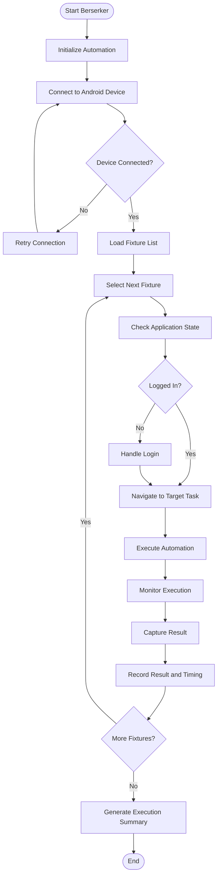

# Berserker — Automation Workflow

A simplified overview of the Android automation process.

## Key workflow stages

1. **Initialization** — Prepare the automation environment.
2. **Device connection** — Establish communication with Android.
3. **Fixture selection** — Choose the next task to execute.
4. **State verification** — Check application and login state.
5. **Task execution** — Perform the required automation.
6. **Monitoring** — Observe execution and capture timing.
7. **Reporting** — Record results and summarize performance.
